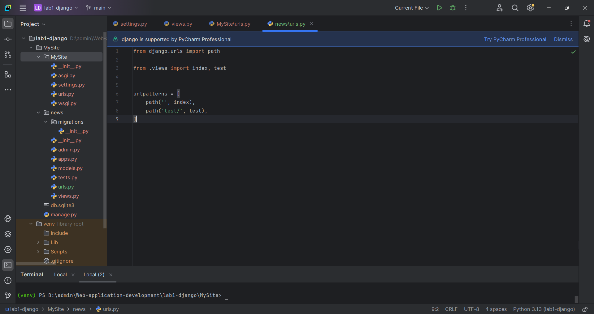
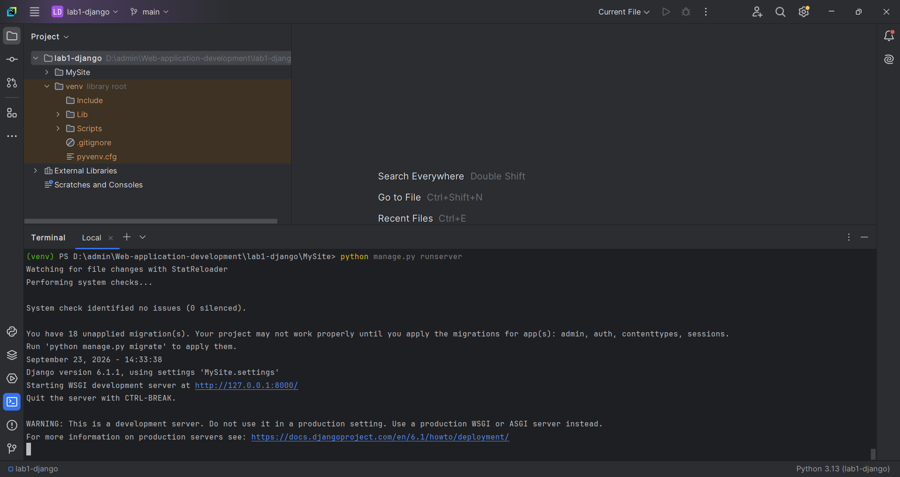
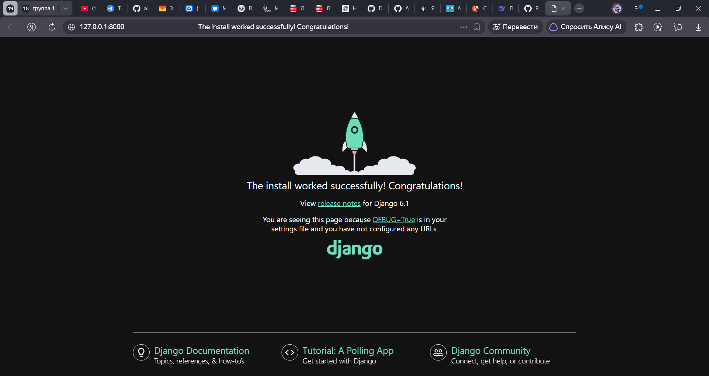
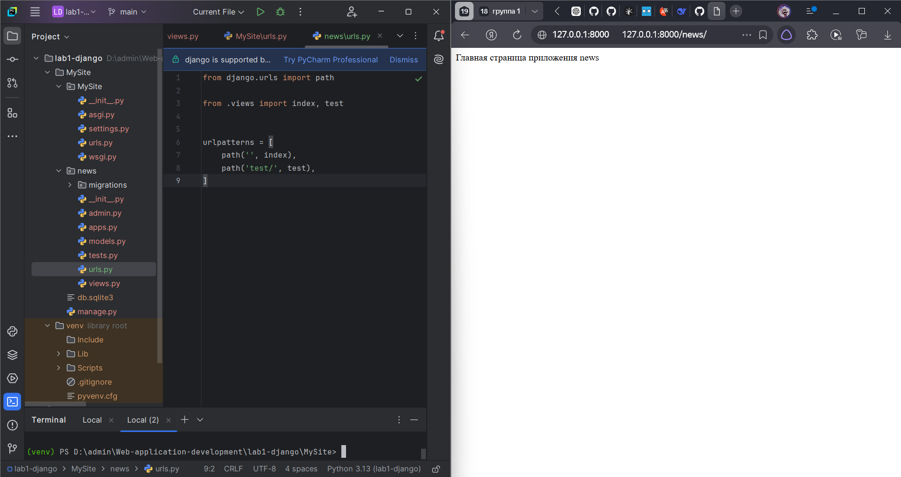
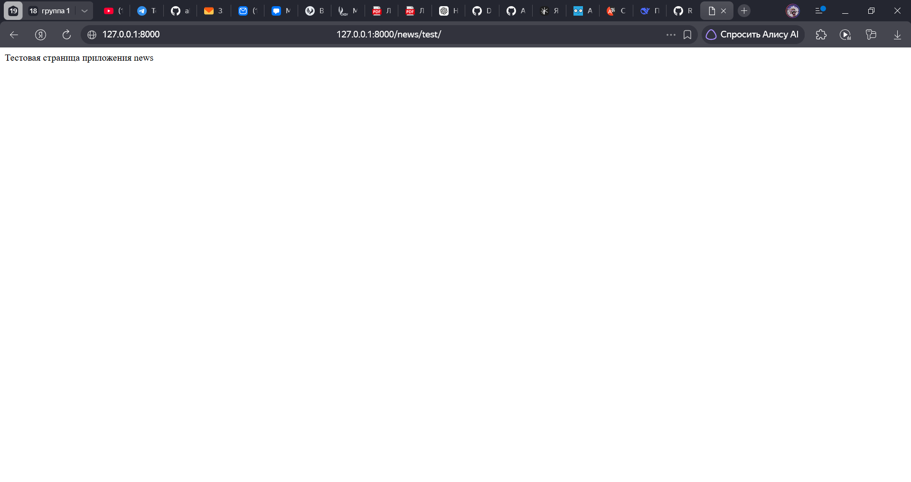
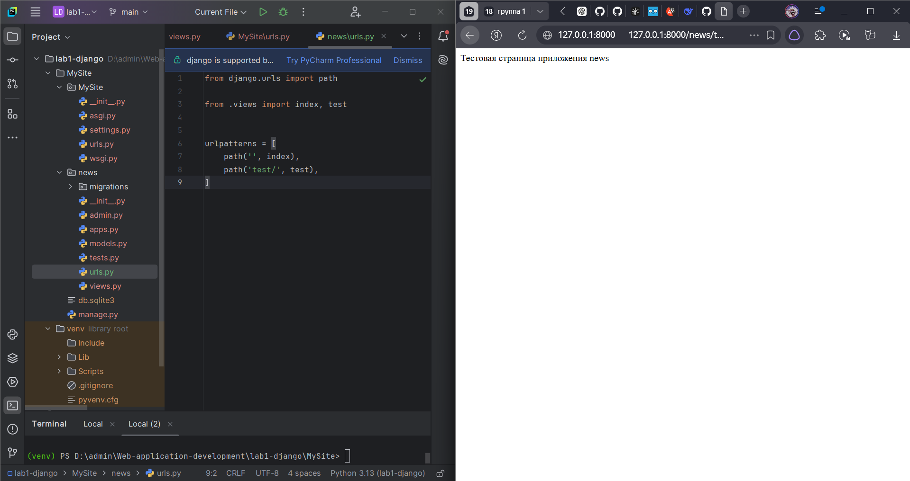

# Лабораторная работа №1. Создание виртуального окружения. Контроллеры и маршруты

## 1. Общая информация

| Параметр                  | Значение                                                |
| ------------------------- | ------------------------------------------------------- |
| Дисциплина                | Разработка веб-приложений                               |
| Номер лабораторной работы | №1                                                      |
| Тема                      | Создание виртуального окружения. Контроллеры и маршруты |
| Язык программирования     | Python                                                  |
| Веб-фреймворк             | Django 6.1.1                                            |
| Версия Python             | 3.13.15                                                 |
| Среда разработки          | PyCharm                                                 |
| Операционная система      | Windows                                                 |
| Уровень выполнения        | Базовый                                                 |

## 2. Цель работы

Настроить виртуальное окружение Python для разработки веб-приложений, установить и освоить основные инструменты Django, создать проект и приложение, разработать контроллеры для обработки HTTP-запросов и организовать маршрутизацию между URL-адресами и соответствующими функциями приложения.

## 3. Задачи лабораторной работы

В ходе выполнения лабораторной работы необходимо:

1. Создать виртуальное окружение Python.
2. Активировать виртуальное окружение и проверить его работоспособность.
3. Установить Django и проверить корректность установки.
4. Изучить основные команды Django.
5. Создать Django-проект с названием `MySite`.
6. Запустить встроенный сервер разработки.
7. Создать приложение `news`.
8. Зарегистрировать приложение в настройках проекта.
9. Разработать контроллеры `index` и `test`.
10. Изучить принцип формирования HTTP-ответов с помощью `HttpResponse`.
11. Настроить маршруты для обращения к контроллерам.
12. Вынести маршруты приложения в отдельный файл `news/urls.py`.
13. Использовать функцию `include()` для подключения маршрутов приложения к основному маршрутизатору.
14. Проверить работоспособность созданных страниц в браузере.

## 4. Используемые технологии и инструменты

| Технология / инструмент | Назначение                                                         |
| ----------------------- | ------------------------------------------------------------------ |
| Python 3.13.15          | Основной язык программирования                                     |
| Django 6.1.1            | Веб-фреймворк для создания приложения                              |
| pip                     | Установка и управление Python-пакетами                             |
| venv                    | Создание изолированного виртуального окружения                     |
| PyCharm                 | Среда разработки и редактирования проекта                          |
| SQLite                  | Система управления базами данных, используемая Django по умолчанию |
| PowerShell              | Выполнение команд и управление проектом                            |
| Git                     | Контроль версий проекта                                            |
| GitHub                  | Хранение исходного кода и отчётной документации                    |

## 5. Структура проекта

Проект размещён в репозитории [Web-application-development](https://github.com/Dexon366/Web-application-development).

```text
Web-application-development/
│
├── .gitignore
├── README.md
│
├── screenshots/
│
└── lab1-django/
    │
    ├── README.md
    ├── requirements.txt
    │
    └── MySite/
        │
        ├── manage.py
        │
        ├── MySite/
        │   ├── __init__.py
        │   ├── asgi.py
        │   ├── settings.py
        │   ├── urls.py
        │   └── wsgi.py
        │
        └── news/
            ├── migrations/
            │   └── __init__.py
            ├── __init__.py
            ├── admin.py
            ├── apps.py
            ├── models.py
            ├── tests.py
            ├── urls.py
            └── views.py
```

Виртуальное окружение `venv` создаётся непосредственно в папке `lab1-django`, но не включается в репозиторий благодаря настройкам `.gitignore`.

### 5.1. Описание основных файлов

**manage.py**

Главный файл управления Django-проектом. Используется для выполнения административных команд: запуска сервера, создания приложений, выполнения миграций и других операций.

**settings.py**

Файл конфигурации проекта. Содержит настройки установленных приложений, базы данных, middleware, шаблонов, статических файлов и других компонентов Django.

**urls.py (пакет MySite)**

Главный маршрутизатор проекта. Определяет соответствие между URL-адресами и обработчиками запросов. В данной лабораторной используется для подключения маршрутов приложения `news`.

**views.py**

Файл приложения, в котором располагаются контроллеры. Контроллеры принимают HTTP-запросы и возвращают HTTP-ответы.

**urls.py (приложение news)**

Содержит маршруты непосредственно приложения `news`. Позволяет отделить маршрутизацию приложения от общей маршрутизации проекта.

**apps.py**

Содержит конфигурацию приложения Django.

**models.py**

Предназначен для описания моделей данных, которые используются для взаимодействия с базой данных. В рамках данной лабораторной собственные модели не создавались.

**admin.py**

Используется для регистрации моделей в административной панели Django.

**tests.py**

Предназначен для размещения автоматизированных тестов приложения.

**migrations/**

Каталог для хранения файлов миграций, связанных с изменениями структуры моделей базы данных.

**requirements.txt**

Содержит список установленных зависимостей проекта и их версий. Позволяет восстановить необходимое окружение на другом компьютере.

## 6. Ход выполнения лабораторной работы

### 6.1. Создание виртуального окружения

Для изоляции зависимостей проекта было создано отдельное виртуальное окружение Python с помощью встроенного модуля `venv`.

Команда создания окружения:

```powershell
python -m venv venv
```

В результате выполнения команды появилась директория `venv`, содержащая отдельный интерпретатор Python и необходимые компоненты для установки библиотек.

Для активации виртуального окружения в Windows PowerShell использовалась команда:

```powershell
.\venv\Scripts\Activate.ps1
```

После успешной активации в начале командной строки появилось обозначение `(venv)`, подтверждающее использование виртуального окружения.

Для проверки установленного интерпретатора использовались команды:

```powershell
python --version
where.exe python
```

Результат проверки:

- Python 3.13.15;
- активный интерпретатор расположен в `venv\Scripts\python.exe`.

### 6.2. Установка Django

Для управления Python-пакетами используется менеджер `pip`.

Перед установкой Django была выполнена проверка списка установленных библиотек:

```powershell
pip list
```

После этого был обновлён установщик пакетов:

```powershell
python -m pip install --upgrade pip
```

Установка Django выполнялась следующей командой:

```powershell
python -m pip install Django
```

Для проверки корректности установки использовалась команда:

```powershell
django-admin --version
```

В результате была установлена и проверена версия Django 6.1.1.

### 6.3. Создание Django-проекта

После настройки виртуального окружения и установки Django был создан проект `MySite`.

Для этого использовалась команда:

```powershell
django-admin startproject MySite
```

Команда `startproject` автоматически создала структуру Django-проекта, включающую управляющий файл `manage.py` и внутренний пакет конфигурации.

Внутренний пакет содержит следующие файлы:

- `settings.py` — настройки проекта;
- `urls.py` — основной маршрутизатор;
- `asgi.py` — точка входа для ASGI-серверов;
- `wsgi.py` — точка входа для WSGI-серверов;
- `__init__.py` — обозначает каталог как Python-пакет.

Таким образом, была создана основа будущего веб-приложения.

### 6.4. Первый запуск проекта

Для запуска Django-проекта необходимо перейти в каталог, содержащий `manage.py`:

```powershell
cd MySite
```

После этого запускается встроенный сервер разработки:

```powershell
python manage.py runserver
```

По умолчанию сервер запускается по адресу:

```text
http://127.0.0.1:8000/
```

После открытия адреса в браузере отображается стандартная стартовая страница Django, подтверждающая успешное создание проекта и работу сервера.

В терминале также отображаются сведения о поступающих HTTP-запросах, включая адрес запрашиваемой страницы и HTTP-статус ответа.

Встроенный сервер автоматически отслеживает изменения в существующих файлах проекта и перезапускается при обнаружении изменений. Для остановки сервера используется сочетание клавиш `Ctrl + C`.

### 6.5. Создание приложения news

В Django проект может состоять из нескольких отдельных приложений, каждое из которых отвечает за определённую функциональность.

Для данной лабораторной было создано приложение `news`, предназначенное для демонстрации работы контроллеров и маршрутизации.

Создание приложения выполнялось из каталога, в котором находится `manage.py`:

```powershell
python manage.py startapp news
```

После выполнения команды Django создал каталог `news` с необходимыми служебными файлами.

### 6.6. Регистрация приложения

После создания приложение необходимо зарегистрировать в настройках проекта.

Для этого был открыт файл:

```text
MySite/settings.py
```

В список `INSTALLED_APPS` добавлено приложение `news`.

```python
INSTALLED_APPS = [
    'django.contrib.admin',
    'django.contrib.auth',
    'django.contrib.contenttypes',
    'django.contrib.sessions',
    'django.contrib.messages',
    'django.contrib.staticfiles',
    'news',
]
```

`INSTALLED_APPS` содержит перечень приложений, которые Django должен учитывать при работе проекта.

Регистрация позволяет фреймворку обнаруживать приложение и использовать его компоненты.

### 6.7. Создание контроллеров

Для обработки HTTP-запросов в приложении используется файл `views.py`.

В нём были реализованы две функции-контроллера: `index` и `test`.

Для формирования HTTP-ответов импортируется класс `HttpResponse`:

```python
from django.http import HttpResponse
```

Полный код файла `news/views.py`:

```python
from django.http import HttpResponse


def index(request):
    return HttpResponse("Главная страница приложения news")


def test(request):
    return HttpResponse("Тестовая страница приложения news")
```

**Функция index**

Принимает объект `request`, содержащий информацию о поступившем HTTP-запросе, и возвращает ответ с текстом главной страницы приложения.

**Функция test**

Предназначена для проверки работы дополнительного контроллера и возвращает отдельный HTTP-ответ с текстом тестовой страницы.

**HttpResponse**

Класс Django, позволяющий сформировать HTTP-ответ и передать его клиенту. В данном случае в качестве содержимого ответа используется обычная текстовая строка.

### 6.8. Настройка основной маршрутизации

Для определения того, какой контроллер должен обрабатывать определённый URL-адрес, в Django используется маршрутизатор.

Основной файл маршрутизации проекта:

```text
MySite/urls.py
```

Для создания маршрутов используется функция `path()` из модуля `django.urls`.

На первоначальном этапе маршруты были непосредственно связаны с контроллерами приложения:

```python
from django.contrib import admin
from django.urls import path
from news.views import index, test


urlpatterns = [
    path('admin/', admin.site.urls),
    path('news/', index),
    path('news/test/', test),
]
```

В результате были созданы два маршрута:

- `news/` — вызывает контроллер `index`;
- `news/test/` — вызывает контроллер `test`.

При обращении пользователя к одному из этих адресов Django проверяет список маршрутов и вызывает соответствующую функцию.

### 6.9. Разделение маршрутов приложения

Для улучшения структуры проекта маршруты приложения были вынесены из основного маршрутизатора в отдельный файл.

В каталоге `news` был создан файл:

```text
news/urls.py
```

Его содержимое:

```python
from django.urls import path

from .views import index, test


urlpatterns = [
    path('', index),
    path('test/', test),
]
```

В этом файле описываются маршруты непосредственно приложения `news`.

Функция `path()` связывает относительный URL-адрес с соответствующим контроллером.

После этого основной маршрутизатор проекта был изменён.

Итоговое содержимое `MySite/urls.py`:

```python
from django.contrib import admin
from django.urls import include, path


urlpatterns = [
    path('admin/', admin.site.urls),
    path('news/', include('news.urls')),
]
```

Для подключения маршрутов приложения используется функция `include()`.

Она позволяет передать обработку всех адресов, начинающихся с `news/`, маршрутизатору приложения `news`.

Таким образом, маршруты проекта и маршруты отдельного приложения были логически разделены.

### 6.10. Принцип обработки запросов

После разделения маршрутов обработка HTTP-запросов происходит следующим образом.

При обращении к адресу:

```text
http://127.0.0.1:8000/news/
```

Django сначала обращается к главному маршрутизатору проекта и обнаруживает маршрут:

```python
path('news/', include('news.urls'))
```

После этого управление передаётся маршрутизатору приложения `news`.

В нём находится маршрут:

```python
path('', index)
```

В результате вызывается контроллер `index`.

Аналогичным образом обрабатывается адрес:

```text
http://127.0.0.1:8000/news/test/
```

Главный маршрутизатор передаёт запрос приложению `news`, после чего внутренний маршрутизатор находит маршрут `test/` и вызывает функцию `test`.

Такая организация позволяет добавлять новые страницы приложения, не перегружая основной файл маршрутизации проекта.

## 7. Реализованные URL-маршруты

В результате выполнения лабораторной работы были реализованы следующие маршруты:

| № | URL-адрес     | Контроллер                  | Назначение                       | Ожидаемый результат       |
| - | ------------- | --------------------------- | -------------------------------- | ------------------------- |
| 1 | `/`           | Стандартная страница Django | Проверка запуска проекта         | Стартовая страница Django |
| 2 | `/admin/`     | Django Admin                | Доступ к административной панели | Страница авторизации      |
| 3 | `/news/`      | `index()`                   | Главная страница приложения      | Текст главной страницы    |
| 4 | `/news/test/` | `test()`                    | Тестовая страница приложения     | Текст тестовой страницы   |

## 8. Проверка работоспособности

После завершения настройки маршрутизации была проведена проверка созданных страниц в браузере.

Для этого использовался встроенный сервер разработки Django:

```powershell
python manage.py runserver
```

Проверка выполнялась по следующим адресам.

| Адрес                              | Проверяемая функциональность                         | Ожидаемый результат               |
| ---------------------------------- | ---------------------------------------------------- | --------------------------------- |
| `http://127.0.0.1:8000/`           | Запуск Django-проекта                                | Стартовая страница Django         |
| `http://127.0.0.1:8000/admin/`     | Работа стандартного маршрута административной панели | Страница авторизации              |
| `http://127.0.0.1:8000/news/`      | Работа контроллера `index`                           | Главная страница приложения news  |
| `http://127.0.0.1:8000/news/test/` | Работа контроллера `test`                            | Тестовая страница приложения news |

Все реализованные маршруты были проверены в браузере. Обе страницы приложения корректно обрабатывают запросы и возвращают ожидаемые текстовые ответы.

## 9. Запуск проекта

Для запуска проекта на другом компьютере необходимо выполнить следующие действия.

### 9.1. Клонирование репозитория

```powershell
git clone https://github.com/Dexon366/Web-application-development.git
```

Переход в каталог лабораторной работы:

```powershell
cd Web-application-development\lab1-django
```

### 9.2. Создание виртуального окружения

```powershell
python -m venv venv
```

### 9.3. Активация окружения

```powershell
.\venv\Scripts\Activate.ps1
```

### 9.4. Установка зависимостей

```powershell
pip install -r requirements.txt
```

### 9.5. Переход в каталог проекта

```powershell
cd MySite
```

### 9.6. Запуск сервера

```powershell
python manage.py runserver
```

После запуска приложение будет доступно по адресу:

```text
http://127.0.0.1:8000/
```

Для остановки сервера необходимо нажать `Ctrl + C` в терминале.

## 10. Скриншоты выполнения лабораторной работы

В данном разделе представлены основные этапы выполнения лабораторной работы.

10.1. Создание и запуск проекта

<details>
<summary>Скриншот 1 — Структура проекта </summary>



</details>

<details>
<summary>Скриншот 2 — Запуск Django в терминале </summary>



</details>

<details>
<summary>Скриншот 3 — Стартовая страница Django </summary>



</details>

10.2. Разработка приложения и настройка маршрутов

<details>
<summary>Скриншот 4 — Главная страница приложения news </summary>


</details>

<details>
<summary>Скриншот 5 — Страница приложения news и код маршрутизации </summary>



</details>

<details>
<summary>Скриншот 6 — Тестовая страница приложения </summary>



</details>

<details>
<summary>Скриншот 7 — Тестовая страница и код маршрутизации </summary>




</details>

## 11. Контрольные вопросы

Ниже приведены вопросы по основным понятиям и инструментам, использованным при выполнении лабораторной работы.

### 11.1. Основные понятия Python и Django

\<details> \<summary>1. Что такое виртуальное окружение Python и для чего оно используется?\</summary>

Виртуальное окружение Python — это изолированная среда для конкретного проекта, в которой хранятся установленные библиотеки и инструменты.

Оно позволяет разделять зависимости разных проектов. Например, один проект может использовать одну версию Django, а другой — другую, не создавая конфликтов между установленными пакетами.

Для создания виртуального окружения используется команда:

```powershell
python -m venv venv
```

\</details>

\<details> \<summary>2. Для чего используется модуль venv?\</summary>

Модуль `venv` входит в стандартную библиотеку Python и предназначен для создания виртуальных окружений.

С его помощью создаётся отдельная директория с интерпретатором Python, исполняемыми файлами и каталогами для установки библиотек.

\</details>

\<details> \<summary>3. Что такое pip?\</summary>

`pip` — это стандартный инструмент управления пакетами Python. Он позволяет устанавливать, обновлять и удалять сторонние библиотеки.

Например, для установки Django используется команда:

```powershell
pip install Django
```

Для просмотра установленных пакетов:

```powershell
pip list
```

\</details>

\<details> \<summary>4. Что такое Django?\</summary>

Django — это высокоуровневый веб-фреймворк для языка Python, предназначенный для разработки веб-сайтов и веб-приложений.

Он предоставляет готовые инструменты для маршрутизации, обработки HTTP-запросов, работы с базами данных, создания административной панели, управления пользователями и других задач веб-разработки.

\</details>

\<details> \<summary>5. Что такое Django-проект?\</summary>

Django-проект — это основная структура веб-приложения, содержащая общие настройки и конфигурацию сайта.

Он включает пакет конфигурации с файлами `settings.py`, `urls.py`, `asgi.py` и `wsgi.py`, а также управляющий файл `manage.py`.

Внутри одного проекта может находиться несколько независимых по назначению приложений.

\</details>

\<details>
\<summary>6. Чем Django-проект отличается от Django-приложения?\</summary>

Проект отвечает за общую конфигурацию и управление веб-сайтом, а приложение реализует определённую функциональность.

Например, в проекте `MySite` создано приложение `news`, отвечающее за обработку страниц новостного раздела.

Один Django-проект может содержать несколько приложений.

\</details>

### 11.2. Создание и настройка проекта

\<details>
\<summary>7. Для чего используется команда django-admin?\</summary>

`django-admin` — это инструмент командной строки, предоставляемый Django.

Он позволяет создавать проекты, управлять приложениями и выполнять различные административные операции.

Например:

```powershell
django-admin startproject MySite
```

создаёт новый Django-проект с названием `MySite`.

\</details>

\<details>
\<summary>8. Для чего предназначена команда startproject?\</summary>

Команда `startproject` используется для создания нового Django-проекта.

Она автоматически формирует основную структуру каталогов и файлов, необходимых для работы приложения, включая `manage.py` и внутренний пакет конфигурации.

\</details>

\<details>
\<summary>9. Для чего используется файл manage.py?\</summary>

`manage.py` — это управляющий файл Django-проекта.

С его помощью выполняются команды управления проектом, например:

```powershell
python manage.py runserver
python manage.py startapp news
python manage.py migrate
```

Он автоматически использует настройки соответствующего Django-проекта.

\</details>

\<details>
\<summary>10. Что такое файл settings.py?\</summary>

`settings.py` — основной конфигурационный файл Django-проекта.

В нём хранятся настройки установленных приложений, базы данных, middleware, шаблонов, статических файлов и других компонентов.

Одним из наиболее важных параметров является `INSTALLED_APPS`, содержащий список зарегистрированных приложений.

\</details>

\<details>
\<summary>11. Для чего предназначен параметр INSTALLED_APPS?\</summary>

`INSTALLED_APPS` — это список приложений, подключённых к Django-проекту.

После создания приложения его необходимо зарегистрировать в данном списке, чтобы Django мог обнаруживать и использовать его компоненты.

В лабораторной работе в список было добавлено приложение:

```python
'news',
```

\</details>

\<details>
\<summary>12. Что делает команда startapp?\</summary>

Команда `startapp` создаёт новое Django-приложение внутри проекта.

Например:

```powershell
python manage.py startapp news
```

создаёт каталог `news` с файлами `views.py`, `models.py`, `admin.py`, `apps.py`, `tests.py` и каталогом `migrations`.

\</details>

### 11.3. HTTP-запросы и контроллеры

\<details>
\<summary>13. Что такое HTTP?\</summary>

HTTP (Hypertext Transfer Protocol) — это протокол прикладного уровня, используемый для передачи данных между клиентом и сервером.

В веб-приложениях браузер отправляет HTTP-запрос серверу, а сервер возвращает HTTP-ответ с определённым содержимым и статусом.

\</details>

\<details>
\<summary>14. Что такое HTTP-запрос?\</summary>

HTTP-запрос — это сообщение, которое клиент отправляет серверу для получения или изменения определённых данных.

Он может содержать метод запроса, URL-адрес, заголовки и тело сообщения.

В данной лабораторной браузер отправляет GET-запросы при открытии страниц приложения.

\</details>

\<details>
\<summary>15. Что такое HTTP-ответ?\</summary>

HTTP-ответ — это сообщение, которое сервер отправляет клиенту в результате обработки запроса.

Он содержит статус ответа, заголовки и тело сообщения.

В лабораторной работе для формирования ответа используется класс `HttpResponse`, возвращающий текстовое содержимое страницы.

\</details>

\<details>
\<summary>16. Что такое контроллер в Django?\</summary>

Контроллер — это функция или класс, отвечающие за обработку поступившего запроса и формирование ответа.

В данной лабораторной контроллеры реализованы в файле `views.py` в виде функций `index()` и `test()`.

Каждая функция принимает объект запроса и возвращает результат его обработки.

\</details>

\<details>
\<summary>17. Для чего используется файл views.py?\</summary>

`views.py` предназначен для размещения представлений (views), которые обрабатывают HTTP-запросы.

В нём описывается логика обработки запросов и формирование ответов, которые затем передаются клиенту.

В лабораторной работе в этом файле находятся функции `index()` и `test()`.

\</details>

\<details>
\<summary>18. Что такое объект request?\</summary>

`request` — это объект входящего HTTP-запроса, который передаётся представлению Django.

Он содержит информацию о запросе: метод, адрес, параметры, заголовки, cookies и другие данные, необходимые для обработки обращения клиента.

В лабораторной работе объект `request` используется как обязательный аргумент обеих функций-контроллеров.

\</details>

\<details>
\<summary>19. Для чего используется HttpResponse?\</summary>

`HttpResponse` — это класс Django, предназначенный для формирования HTTP-ответа.

С его помощью можно вернуть клиенту текст, HTML-содержимое и другие данные.

В лабораторной работе он используется следующим образом:

```python
return HttpResponse("Главная страница приложения news")
```

В результате браузер получает текстовое содержимое ответа.

\</details>

### 11.4. Маршрутизация

\<details>
\<summary>20. Что такое маршрутизация в Django?\</summary>

Маршрутизация — это механизм сопоставления URL-адресов с соответствующими представлениями.

Когда пользователь открывает определённую страницу, Django проверяет список маршрутов и определяет, какой контроллер должен обработать запрос.

\</details>

\<details>
\<summary>21. Для чего используется файл urls.py?\</summary>

`urls.py` содержит список маршрутов веб-приложения.

В нём определяется, какие URL-адреса должны обрабатываться определёнными представлениями.

В Django могут использоваться как главный файл маршрутизации проекта, так и отдельные файлы маршрутов приложений.

\</details>

\<details>
\<summary>22. Для чего используется функция path()?\</summary>

`path()` используется для объявления маршрута и связывания URL-адреса с представлением.

Например:

```python
path('test/', test)
```

означает, что при обращении к соответствующему адресу будет вызван контроллер `test`.

\</details>

\<details>
\<summary>23. Что такое urlpatterns?\</summary>

`urlpatterns` — это список маршрутов Django.

В нём располагаются вызовы `path()` и другие конструкции маршрутизации, определяющие обработку URL-адресов.

Django использует этот список для поиска подходящего маршрута при поступлении запроса.

\</details>

\<details>
\<summary>24. Для чего используется функция include()?\</summary>

`include()` позволяет подключить маршруты другого модуля или приложения к основному маршрутизатору.

В лабораторной работе она используется следующим образом:

```python
path('news/', include('news.urls'))
```

Это означает, что все адреса, начинающиеся с `news/`, будут дополнительно обрабатываться маршрутизатором приложения `news`.

\</details>

\<details>
\<summary>25. Почему маршруты приложения удобно хранить отдельно?\</summary>

Разделение маршрутов позволяет сделать структуру проекта более понятной и удобной для сопровождения.

Если в проекте несколько приложений, каждое из них может иметь собственный файл `urls.py`.

Благодаря этому главный маршрутизатор отвечает только за подключение приложений, а внутренняя маршрутизация располагается непосредственно в самих приложениях.

\</details>

\<details>
\<summary>26. Как Django определяет, какой контроллер вызвать?\</summary>

При поступлении HTTP-запроса Django обращается к списку маршрутов и проверяет URL-адрес на соответствие объявленным шаблонам.

При нахождении подходящего маршрута вызывается связанное с ним представление.

Если подходящий маршрут не найден, Django возвращает ошибку 404 Not Found.

\</details>

\<details>
\<summary>27. Как работает маршрут path('news/', include('news.urls'))?\</summary>

Сначала Django сопоставляет начало URL-адреса с префиксом `news/`.

Если совпадение найдено, оставшаяся часть адреса передаётся маршрутизатору приложения `news`.

Например, при запросе `/news/test/` приложение получает оставшуюся часть `test/` и определяет соответствующий контроллер.

\</details>

\<details>
\<summary>28. Что произойдёт, если обратиться к несуществующему URL?\</summary>

Если Django не сможет найти подходящий маршрут, он вернёт HTTP-статус 404 Not Found.

Это означает, что запрашиваемый адрес не соответствует ни одному зарегистрированному маршруту.

Во время разработки Django дополнительно отображает диагностическую страницу с информацией о запросе и доступных маршрутах.

\</details>

### 11.5. Запуск и организация проекта

\<details>
\<summary>29. Для чего используется команда runserver?\</summary>

Команда `runserver` запускает встроенный сервер разработки Django.

Она позволяет проверять работу веб-приложения локально, без установки отдельного веб-сервера.

Для запуска используется команда:

```powershell
python manage.py runserver
```

По умолчанию сервер доступен по адресу `http://127.0.0.1:8000/`.

Встроенный сервер предназначен для разработки и тестирования, а не для промышленного размещения сайта.

\</details>

\<details>
\<summary>30. Что такое SQLite и почему она используется в Django?\</summary>

SQLite — это компактная реляционная система управления базами данных, которая хранит данные в одном файле.

Django использует SQLite в качестве базы данных по умолчанию при создании нового проекта.

Её не требуется устанавливать и настраивать как отдельный сервер баз данных для выполнения простых учебных проектов.

В рамках данной лабораторной собственные модели и операции с базой данных не реализовывались, поскольку основное внимание уделялось созданию контроллеров и настройке маршрутизации.

\</details>

## 12. Результаты выполнения лабораторной работы

В ходе выполнения лабораторной работы было настроено рабочее окружение Python и установлен веб-фреймворк Django.

Создан проект `MySite`, запущен встроенный сервер разработки и создано приложение `news`.

В приложении реализованы два контроллера:

- `index()` — возвращает текст главной страницы;
- `test()` — возвращает текст тестовой страницы.

Для формирования HTTP-ответов использован класс `HttpResponse`.

Выполнена регистрация приложения в `INSTALLED_APPS`, настроена маршрутизация и реализовано разделение маршрутов между проектом и приложением с помощью функции `include()`.

В результате созданы и проверены две рабочие страницы:

- `http://127.0.0.1:8000/news/`;
- `http://127.0.0.1:8000/news/test/`.

Исходный код, зависимости и документация лабораторной работы размещены в GitHub-репозитории.

## 13. Вывод

В результате выполнения первой лабораторной работы были получены практические навыки настройки среды разработки Python и работы с веб-фреймворком Django.

Были изучены основные этапы создания Django-проекта и приложения, принципы организации структуры проекта, регистрация приложений и назначение основных конфигурационных файлов.

Особое внимание было уделено обработке HTTP-запросов и формированию ответов с помощью контроллеров. Также был изучен механизм маршрутизации Django, включая использование функций `path()` и `include()`.

В ходе работы удалось реализовать отдельные страницы приложения `news`, проверить их доступность через браузер и организовать маршруты таким образом, чтобы конфигурация проекта и маршрутизация приложения были разделены.

Таким образом, цель лабораторной работы достигнута: виртуальное окружение настроено, Django-проект создан, контроллеры разработаны, а маршрутизация приложения успешно реализована и проверена.
