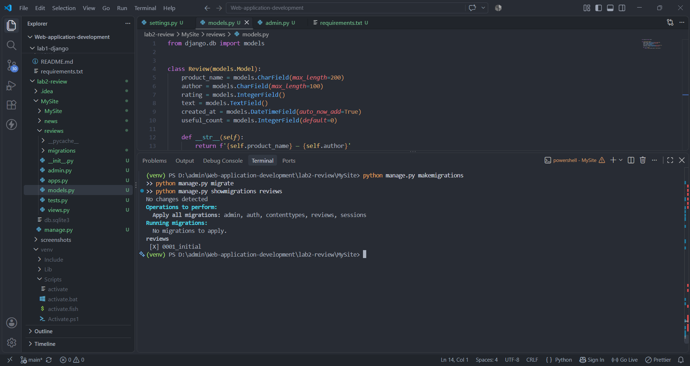
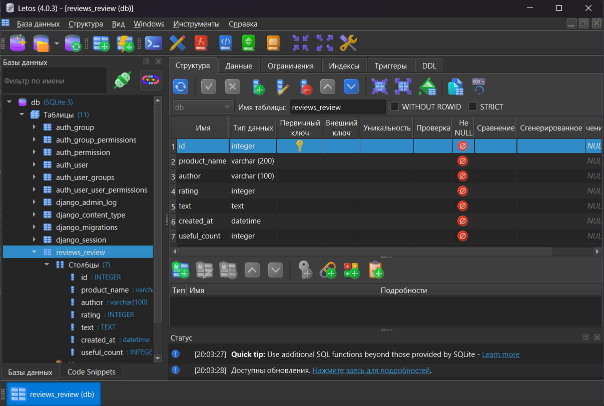
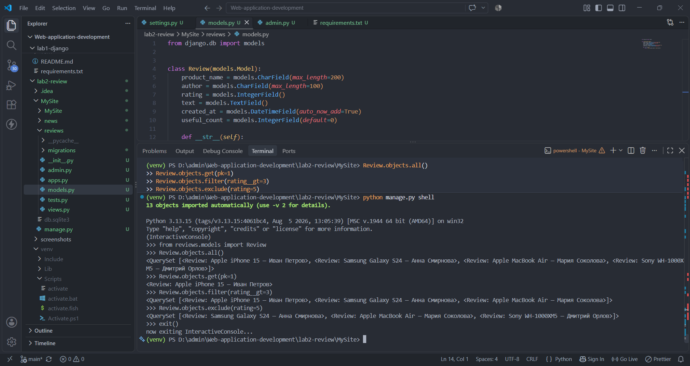
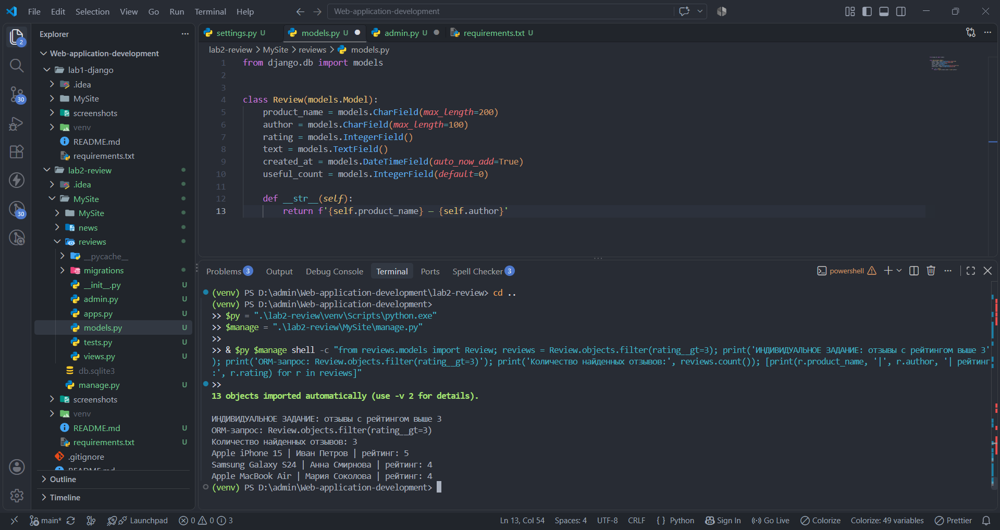
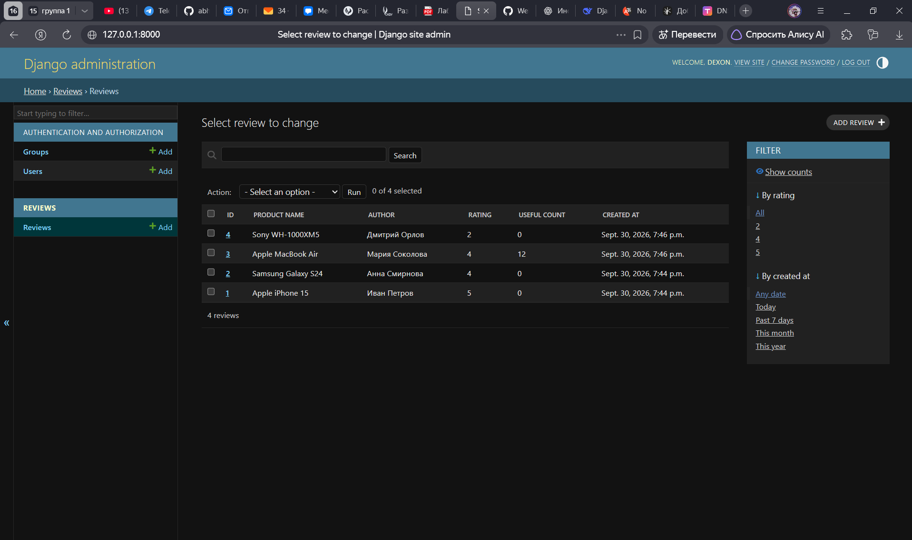

# Лабораторная работа №2. Работа с моделями и базой данных в Django

## 1. Тема работы

Создание модели Django, выполнение миграций, работа с базой данных SQLite, выполнение CRUD-операций и запросов ORM, настройка административной панели Django.

**Вариант:** 6.

## 2. Цель работы

Изучить механизм создания моделей в Django, научиться описывать структуру данных с помощью ORM, создавать и применять миграции, выполнять запросы к базе данных, изменять записи и настраивать административную панель для управления объектами модели.

В рамках индивидуального задания необходимо получить отзывы, рейтинг которых выше 3.

## 3. Используемые технологии

- Python 3.13.15.
- Django 6.1.1.
- SQLite — реляционная база данных.
- Django ORM — инструмент взаимодействия с базой данных через Python.
- Django Admin — встроенная административная панель.
- PowerShell — запуск команд и проверка результатов.
- Git и GitHub — хранение и версионирование проекта.

## 4. Структура проекта

Основная часть лабораторной находится в каталоге `lab2-review/`.

```text
lab2-review/
├── MySite/
│   ├── MySite/
│   │   ├── settings.py
│   │   └── urls.py
│   ├── news/
│   ├── reviews/
│   │   ├── migrations/
│   │   │   └── 0001_initial.py
│   │   ├── admin.py
│   │   ├── apps.py
│   │   ├── models.py
│   │   ├── tests.py
│   │   └── views.py
│   ├── db.sqlite3
│   └── manage.py
├── screenshots/
├── README.md
└── requirements.txt
```

Приложение `reviews` отвечает за хранение и обработку отзывов. Файл `models.py` содержит описание модели, `admin.py` — настройку административной панели, а каталог `migrations` — файлы изменений структуры базы данных.

Виртуальное окружение `venv` используется локально и не включается в репозиторий.

## 5. Создание модели Review

Для хранения отзывов создана модель `Review` в файле `reviews/models.py`.

```python
from django.db import models


class Review(models.Model):
    product_name = models.CharField(max_length=200)
    author = models.CharField(max_length=100)
    rating = models.IntegerField()
    text = models.TextField()
    created_at = models.DateTimeField(auto_now_add=True)
    useful_count = models.IntegerField(default=0)

    def __str__(self):
        return f'{self.product_name} — {self.author}'
```

### Назначение полей модели

| Поле | Тип | Назначение |
|---|---|---|
| `product_name` | `CharField` | Название товара, максимум 200 символов |
| `author` | `CharField` | Имя автора, максимум 100 символов |
| `rating` | `IntegerField` | Числовой рейтинг товара |
| `text` | `TextField` | Текст отзыва |
| `created_at` | `DateTimeField` | Дата и время создания записи |
| `useful_count` | `IntegerField` | Количество отметок полезности, по умолчанию 0 |

Метод `__str__()` возвращает название товара и имя автора. Благодаря этому записи модели имеют понятное текстовое представление в административной панели и при работе через Django shell.

Параметр `auto_now_add=True` автоматически сохраняет время создания объекта. Параметр `default=0` задаёт начальное значение количества отметок полезности.

## 6. Создание и применение миграций

После создания модели была сформирована миграция, описывающая изменения структуры базы данных.

Для создания миграции используется команда:

```powershell
python manage.py makemigrations reviews
```

Для просмотра SQL-команд, соответствующих миграции:

```powershell
python manage.py sqlmigrate reviews 0001
```

Для применения миграций:

```powershell
python manage.py migrate
```

Для проверки состояния миграций приложения:

```powershell
python manage.py showmigrations reviews
```

В результате была создана миграция `0001_initial.py`. Проверка `showmigrations reviews` подтвердила, что миграция применена: `[X] 0001_initial`.

Миграции позволяют сохранять историю изменений моделей и согласовывать структуру базы данных с кодом приложения.

<details open>
<summary>Скриншот 1. Создание и применение миграций</summary>



На скриншоте показаны команды управления миграциями и подтверждение применения `0001_initial`.
</details>

## 7. Работа с базой данных SQLite

В проекте используется база данных SQLite, хранящаяся в файле `MySite/db.sqlite3`.

Для модели `Review` Django создаёт таблицу `reviews_review`. Название образуется из имени приложения и имени модели.

Таблица содержит поля, соответствующие атрибутам модели, а также автоматически создаваемый первичный ключ `id`.

Проверить содержимое таблицы можно через SQLiteStudio или с помощью Django shell. В ходе проверки было обнаружено четыре записи.

<details open>
<summary>Скриншот 2. Таблица reviews_review в SQLiteStudio</summary>



Скриншот демонстрирует структуру таблицы и сохранённые отзывы.
</details>

## 8. Работа с Django ORM

Django ORM позволяет обращаться к записям базы данных с помощью Python-объектов и методов модели.

Для проверки были выполнены следующие запросы.

### 8.1. Получение всех отзывов

```python
Review.objects.all()
```

Метод `all()` возвращает набор всех объектов модели `Review`. В текущей базе данных находится четыре отзыва.

### 8.2. Получение одной записи

```python
Review.objects.get(pk=1)
```

Метод `get()` получает одну запись по первичному ключу. В проверке был получен отзыв Apple iPhone 15 автора Иван Петров.

Если подходящая запись отсутствует или условию соответствует несколько записей, метод `get()` вызывает исключение.

### 8.3. Фильтрация записей

```python
Review.objects.filter(rating__gt=3)
```

Метод `filter()` выбирает объекты, удовлетворяющие указанному условию. Выражение `rating__gt=3` означает, что рейтинг должен быть строго больше 3.

### 8.4. Исключение записей

```python
Review.objects.exclude(rating=5)
```

Метод `exclude()` возвращает записи, которые не соответствуют заданному условию. В данном случае исключаются отзывы с рейтингом 5.

Выполнение запросов подтвердило корректную работу ORM с существующими данными.

<details open>
<summary>Скриншот 3. Результаты ORM-запросов</summary>



На скриншоте представлены результаты `all()`, `get()`, `filter()` и `exclude()`.
</details>

## 9. Индивидуальное задание: отзывы с рейтингом выше 3

Для выполнения индивидуального задания использован запрос:

```python
Review.objects.filter(rating__gt=3)
```

Условие `rating__gt=3` выбирает только те отзывы, у которых значение поля `rating` больше трёх. Отзывы с рейтингом 3 и ниже в результат не включаются.

Для наглядной проверки результата применён следующий код:

```python
from reviews.models import Review

reviews = Review.objects.filter(rating__gt=3)

print('Количество найденных отзывов:', reviews.count())

for review in reviews:
    print(
        review.product_name,
        '|',
        review.author,
        '| рейтинг:',
        review.rating
    )
```

По результатам проверки были найдены три отзыва:

| Товар | Автор | Рейтинг |
|---|---|---:|
| Apple iPhone 15 | Иван Петров | 5 |
| Samsung Galaxy S24 | Анна Смирнова | 4 |
| Apple MacBook Air | Мария Соколова | 4 |

Таким образом, индивидуальное задание выполнено: ORM-запрос возвращает три записи с рейтингом выше 3.

<details open>
<summary>Скриншот 4. Выполнение индивидуального задания</summary>



Скриншот содержит ORM-запрос, количество найденных записей и вывод подходящих отзывов.
</details>

## 10. Операции с объектами модели

При работе с Django ORM используются четыре основные операции CRUD:

- **Create** — создание новой записи.
- **Read** — получение существующих записей.
- **Update** — изменение сохранённого объекта.
- **Delete** — удаление записи.

Пример создания отзыва:

```python
Review.objects.create(
    product_name='Пример товара',
    author='Тестовый автор',
    rating=4,
    text='Пример текста отзыва'
)
```

Пример изменения существующего объекта:

```python
review = Review.objects.get(pk=3)
review.rating = 4
review.useful_count = 12
review.save()
```

В ходе работы была проверена запись Apple MacBook Air с рейтингом 4 и значением `useful_count = 12`.

Пример удаления объекта:

```python
review = Review.objects.get(pk=5)
review.delete()
```

Удаление следует выполнять только для той записи, которую действительно требуется удалить. Перед выполнением необходимо проверить её идентификатор и содержимое.

В текущем состоянии базы данных сохранены четыре отзыва. Операции изменения и чтения подтверждены проверкой данных; создание и удаление записей следует демонстрировать отдельными результатами выполнения, если этого требует методическое задание.

## 11. Настройка административной панели

Для управления отзывами используется встроенная административная панель Django.

В файле `reviews/admin.py` модель зарегистрирована с помощью декоратора `@admin.register(Review)`.

Для удобства работы настроены следующие параметры:

- `list_display` — отображение идентификатора, товара, автора, рейтинга, количества отметок полезности и даты создания;
- `list_filter` — фильтрация по рейтингу и дате создания;
- `search_fields` — поиск по названию товара, автору и тексту отзыва.

Такой интерфейс позволяет просматривать записи, находить нужные отзывы, фильтровать результаты и выполнять стандартные операции управления объектами.

Для доступа к панели используется маршрут `/admin/`. Вход в административную панель был успешно выполнен.

<details open>
<summary>Скриншот 5. Список отзывов в Django Admin</summary>



На скриншоте показан список объектов модели `Review` в административной панели.
</details>

## 12. Работа с медиафайлами

В модели `Review` отсутствуют поля `ImageField` и `FileField`. Для выполнения заданий с текущей моделью хранение загружаемых изображений и файлов не требуется.

Поэтому в рамках данной лабораторной настройка `MEDIA_ROOT`, `MEDIA_URL` и обработка загруженных файлов не являются необходимыми для реализации модели отзывов.


## 13. Контрольные вопросы 

#### 1. Что такое модель в Django и для чего она используется?

Модель — это класс Python, который описывает структуру данных приложения и определяет, как они хранятся в базе данных. Модели используются для создания, хранения, изменения и получения данных. Они располагаются в файле `models.py`.

Пример:

```python
from django.db import models

class Student(models.Model):
    name = models.CharField(max_length=100)
    age = models.IntegerField()
```

#### 2. Какие типы полей вы знаете? Приведите примеры.

В Django существуют следующие типы полей моделей:

- `CharField` — строка ограниченной длины.
- `TextField` — текст произвольной длины.
- `IntegerField` — целое число.
- `FloatField` — число с плавающей точкой.
- `BooleanField` — логическое значение.
- `DateField` — дата.
- `DateTimeField` — дата и время.
- `EmailField` — адрес электронной почты.
- `ImageField` — изображение.
- `FileField` — файл.
- `ForeignKey` — связь «многие к одному».
- `ManyToManyField` — связь «многие ко многим».
- `OneToOneField` — связь «один к одному».

Пример использования:

```python
name = models.CharField(max_length=100)
age = models.IntegerField()
email = models.EmailField()
```

#### 3. Чем отличаются параметры `blank=True` и `null=True`?

Параметр `blank=True` разрешает оставлять поле незаполненным при проверке данных, например в формах. Параметр `null=True` разрешает хранить в базе данных значение `NULL`.

Пример:

```python
description = models.TextField(blank=True)
age = models.IntegerField(null=True, blank=True)
```

Таким образом, `blank` отвечает за проверку заполненности поля, а `null` — за хранение значения в базе данных. Для текстовых полей обычно используют `blank=True` без `null=True`.

#### 4. Что такое миграции и зачем они нужны? Опишите основные команды для работы с ними.

Миграции — это механизм Django, позволяющий изменять структуру базы данных в соответствии с изменениями моделей.

Основные команды:

- `python manage.py makemigrations` — создаёт файлы миграций на основе изменений моделей.
- `python manage.py migrate` — применяет миграции к базе данных.
- `python manage.py showmigrations` — показывает список миграций и их статус.
- `python manage.py sqlmigrate имя_приложения номер_миграции` — показывает SQL-команды выбранной миграции.

Обычно сначала выполняют `makemigrations`, а затем `migrate`.

#### 5. Как создать суперпользователя для доступа к административной панели Django?

Для создания суперпользователя необходимо выполнить команду:

```bash
python manage.py createsuperuser
```

Затем нужно указать имя пользователя, адрес электронной почты, если он запрашивается, и пароль.

После запуска проекта административная панель доступна по адресу `http://127.0.0.1:8000/admin/`.

Суперпользователь обладает правами администратора и может управлять данными через административную панель Django.

#### 6. Что такое ORM? Перечислите основные методы для выполнения операций CRUD.

ORM (Object-Relational Mapping) — это технология, позволяющая взаимодействовать с базой данных через объекты и методы Python без необходимости вручную писать SQL-запросы.

CRUD включает четыре основные операции:

- **Create (создание):** `create()`, `save()`.
- **Read (чтение):** `all()`, `filter()`, `get()`.
- **Update (обновление):** изменение полей объекта с последующим вызовом `save()` или использование `update()`.
- **Delete (удаление):** `delete()`.

Пример:

```python
# Создание записи
student = Student.objects.create(name="Иван", age=20)

# Чтение записей
students = Student.objects.all()

# Обновление записи
student.age = 21
student.save()

# Удаление записи
student.delete()
```

ORM упрощает работу с базой данных, делает код понятнее и позволяет использовать разные поддерживаемые СУБД.

#### 7. В чем разница между методами `filter()` и `get()`?

Метод `filter()` возвращает набор записей `QuerySet`, соответствующих заданным условиям. Если совпадений нет, возвращается пустой `QuerySet`.

Метод `get()` возвращает один объект. Если запись не найдена или найдено несколько записей, возникает исключение.

Пример:

```python
# Получение всех студентов старше 18 лет
students = Student.objects.filter(age__gt=18)

# Получение одного студента по ID
student = Student.objects.get(id=1)
```

Метод `filter()` используют для получения одной или нескольких записей, а `get()` — когда ожидается ровно одна запись.

#### 8. Как настроить загрузку изображений (медиафайлов) в проекте Django?

Для загрузки изображений необходимо выполнить следующие действия.

**1. Добавить поле `ImageField` в модель:**

```python
from django.db import models

class Photo(models.Model):
    title = models.CharField(max_length=100)
    image = models.ImageField(upload_to='photos/')
```

**2. Установить библиотеку Pillow:**

```bash
pip install Pillow
```

**3. Настроить `settings.py`:**

```python
MEDIA_URL = '/media/'
MEDIA_ROOT = BASE_DIR / 'media'
```

`MEDIA_URL` задаёт URL для доступа к медиафайлам, а `MEDIA_ROOT` определяет каталог их хранения.

**4. Настроить `urls.py` проекта:**

```python
from django.conf import settings
from django.conf.urls.static import static
from django.urls import path

urlpatterns = [
    # Маршруты приложения
]

if settings.DEBUG:
    urlpatterns += static(
        settings.MEDIA_URL,
        document_root=settings.MEDIA_ROOT
    )
```

**5. Выполнить миграции:**

```bash
python manage.py makemigrations
python manage.py migrate
```

В режиме разработки изображения будут сохраняться в каталоге `media/photos/`. В базе данных хранится путь к изображению, а не сам файл. Для рабочего сервера необходимо отдельно настроить обслуживание медиафайлов.

#### 9. Для чего нужен метод `__str__` в модели?

Метод `__str__` определяет текстовое представление объекта модели. Он используется для удобного отображения объектов, например в административной панели Django, вместо стандартного представления с именем класса и адресом объекта в памяти.

Пример:

```python
class Student(models.Model):
    name = models.CharField(max_length=100)
    age = models.IntegerField()

    def __str__(self):
        return self.name
```

В этом случае объект студента будет отображаться по его имени. Метод `__str__` должен возвращать строку.

#### 10. Что произойдёт, если выполнить `python manage.py makemigrations`, но не выполнить `migrate`?

Команда `makemigrations` создаст файлы миграций, описывающие изменения моделей, но не применит их к базе данных.

Без выполнения `migrate` структура базы данных останется прежней. Например, новая таблица не будет создана, а новый столбец не появится в существующей таблице.

При обращении к данным, для которых необходимые изменения ещё не применены, могут возникнуть ошибки.

Чтобы применить изменения, необходимо выполнить команду:

```bash
python manage.py migrate
```

Таким образом, `makemigrations` подготавливает изменения, а `migrate` применяет их к базе данных.


## 14. Результаты работы

В ходе выполнения лабораторной работы была создана модель `Review` для хранения отзывов о товарах, сформирована и применена миграция `0001_initial`, проверена структура базы данных SQLite и выполнены запросы через Django ORM.

Также была настроена административная панель с отображением основных полей модели, фильтрами и поиском. Индивидуальное задание выполнено с помощью `Review.objects.filter(rating__gt=3)`: запрос вернул три отзыва с рейтингом выше 3.

Работа позволила закрепить навыки описания моделей Django, управления схемой базы данных, получения и изменения записей и использования встроенных инструментов администрирования.

**Вывод:** поставленная цель достигнута в части создания модели, работы с миграциями, ORM-запросами и настройки административной панели. Перед окончательной сдачей необходимо сверить контрольные вопросы с методическими указаниями и приложить скриншоты фактически выполненных операций CRUD, если они требуются отдельно.
