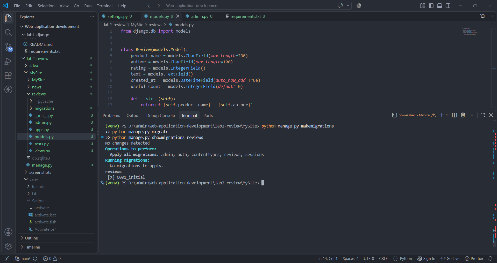
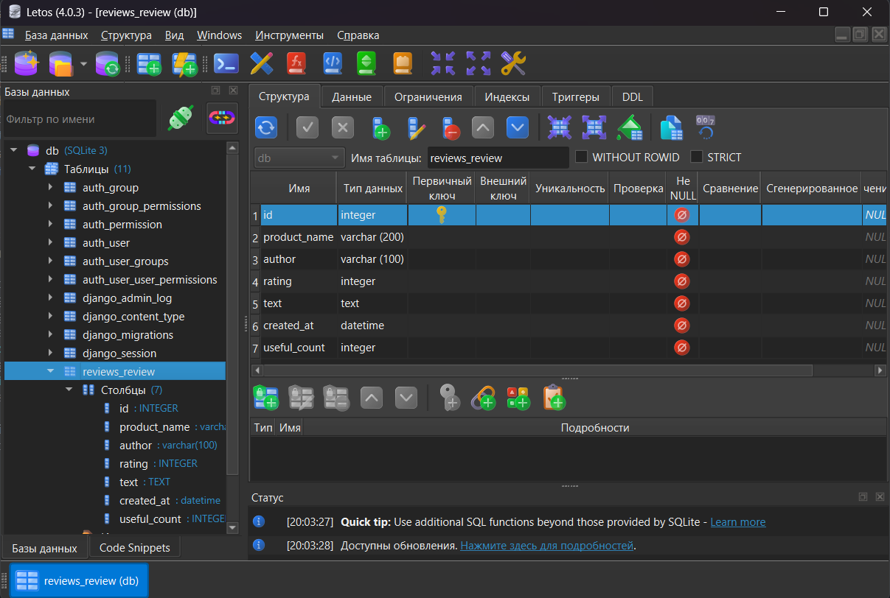
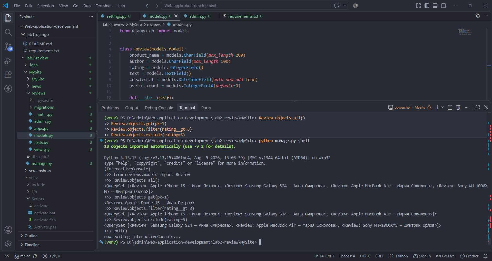
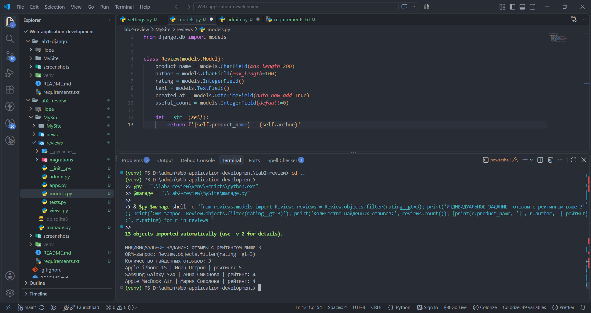
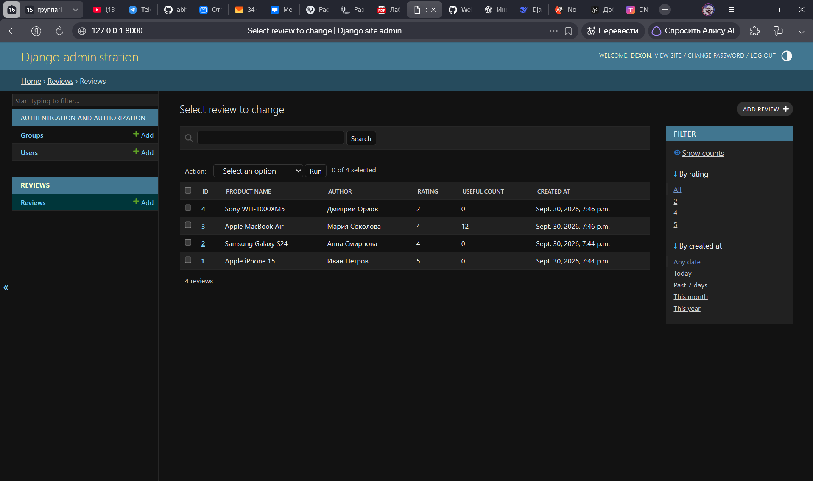

# Лабораторная работа №2. Работа с моделями и базой данных в Django

## 1. Тема работы

Создание модели Django, выполнение миграций, работа с базой данных SQLite, выполнение CRUD-операций и запросов ORM, настройка административной панели Django.

**Вариант:** 6.

## 2. Цель работы

Изучить механизм создания моделей в Django, научиться описывать структуру данных с помощью ORM, создавать и применять миграции, выполнять запросы к базе данных, изменять записи и настраивать административную панель для управления объектами модели.

В рамках индивидуального задания необходимо получить отзывы, рейтинг которых выше 3.

## 3. Используемые технологии

- Python 3.13.15.
- Django 6.1.1.
- SQLite — реляционная база данных.
- Django ORM — инструмент взаимодействия с базой данных через Python.
- Django Admin — встроенная административная панель.
- PowerShell — запуск команд и проверка результатов.
- Git и GitHub — хранение и версионирование проекта.

## 4. Структура проекта

Основная часть лабораторной находится в каталоге `lab2-review/`.

```text
lab2-review/
├── MySite/
│   ├── MySite/
│   │   ├── settings.py
│   │   └── urls.py
│   ├── news/
│   ├── reviews/
│   │   ├── migrations/
│   │   │   └── 0001_initial.py
│   │   ├── admin.py
│   │   ├── apps.py
│   │   ├── models.py
│   │   ├── tests.py
│   │   └── views.py
│   ├── db.sqlite3
│   └── manage.py
├── screenshots/
├── README.md
└── requirements.txt
```

Приложение `reviews` отвечает за хранение и обработку отзывов. Файл `models.py` содержит описание модели, `admin.py` — настройку административной панели, а каталог `migrations` — файлы изменений структуры базы данных.

Виртуальное окружение `venv` используется локально и не включается в репозиторий.

## 5. Создание модели Review

Для хранения отзывов создана модель `Review` в файле `reviews/models.py`.

```python
from django.db import models


class Review(models.Model):
    product_name = models.CharField(max_length=200)
    author = models.CharField(max_length=100)
    rating = models.IntegerField()
    text = models.TextField()
    created_at = models.DateTimeField(auto_now_add=True)
    useful_count = models.IntegerField(default=0)

    def __str__(self):
        return f'{self.product_name} — {self.author}'
```

### Назначение полей модели

| Поле | Тип | Назначение |
|---|---|---|
| `product_name` | `CharField` | Название товара, максимум 200 символов |
| `author` | `CharField` | Имя автора, максимум 100 символов |
| `rating` | `IntegerField` | Числовой рейтинг товара |
| `text` | `TextField` | Текст отзыва |
| `created_at` | `DateTimeField` | Дата и время создания записи |
| `useful_count` | `IntegerField` | Количество отметок полезности, по умолчанию 0 |

Метод `__str__()` возвращает название товара и имя автора. Благодаря этому записи модели имеют понятное текстовое представление в административной панели и при работе через Django shell.

Параметр `auto_now_add=True` автоматически сохраняет время создания объекта. Параметр `default=0` задаёт начальное значение количества отметок полезности.

## 6. Создание и применение миграций

После создания модели была сформирована миграция, описывающая изменения структуры базы данных.

Для создания миграции используется команда:

```powershell
python manage.py makemigrations reviews
```

Для просмотра SQL-команд, соответствующих миграции:

```powershell
python manage.py sqlmigrate reviews 0001
```

Для применения миграций:

```powershell
python manage.py migrate
```

Для проверки состояния миграций приложения:

```powershell
python manage.py showmigrations reviews
```

В результате была создана миграция `0001_initial.py`. Проверка `showmigrations reviews` подтвердила, что миграция применена: `[X] 0001_initial`.

Миграции позволяют сохранять историю изменений моделей и согласовывать структуру базы данных с кодом приложения.

<details open>
<summary>Скриншот 1. Создание и применение миграций</summary>



На скриншоте показаны команды управления миграциями и подтверждение применения `0001_initial`.
</details>

## 7. Работа с базой данных SQLite

В проекте используется база данных SQLite, хранящаяся в файле `MySite/db.sqlite3`.

Для модели `Review` Django создаёт таблицу `reviews_review`. Название образуется из имени приложения и имени модели.

Таблица содержит поля, соответствующие атрибутам модели, а также автоматически создаваемый первичный ключ `id`.

Проверить содержимое таблицы можно через SQLiteStudio или с помощью Django shell. В ходе проверки было обнаружено четыре записи.

<details open>
<summary>Скриншот 2. Таблица reviews_review в SQLiteStudio</summary>



Скриншот демонстрирует структуру таблицы и сохранённые отзывы.
</details>

## 8. Работа с Django ORM

Django ORM позволяет обращаться к записям базы данных с помощью Python-объектов и методов модели.

Для проверки были выполнены следующие запросы.

### 8.1. Получение всех отзывов

```python
Review.objects.all()
```

Метод `all()` возвращает набор всех объектов модели `Review`. В текущей базе данных находится четыре отзыва.

### 8.2. Получение одной записи

```python
Review.objects.get(pk=1)
```

Метод `get()` получает одну запись по первичному ключу. В проверке был получен отзыв Apple iPhone 15 автора Иван Петров.

Если подходящая запись отсутствует или условию соответствует несколько записей, метод `get()` вызывает исключение.

### 8.3. Фильтрация записей

```python
Review.objects.filter(rating__gt=3)
```

Метод `filter()` выбирает объекты, удовлетворяющие указанному условию. Выражение `rating__gt=3` означает, что рейтинг должен быть строго больше 3.

### 8.4. Исключение записей

```python
Review.objects.exclude(rating=5)
```

Метод `exclude()` возвращает записи, которые не соответствуют заданному условию. В данном случае исключаются отзывы с рейтингом 5.

Выполнение запросов подтвердило корректную работу ORM с существующими данными.

<details open>
<summary>Скриншот 3. Результаты ORM-запросов</summary>



На скриншоте представлены результаты `all()`, `get()`, `filter()` и `exclude()`.
</details>

## 9. Индивидуальное задание: отзывы с рейтингом выше 3

Для выполнения индивидуального задания использован запрос:

```python
Review.objects.filter(rating__gt=3)
```

Условие `rating__gt=3` выбирает только те отзывы, у которых значение поля `rating` больше трёх. Отзывы с рейтингом 3 и ниже в результат не включаются.

Для наглядной проверки результата применён следующий код:

```python
from reviews.models import Review

reviews = Review.objects.filter(rating__gt=3)

print('Количество найденных отзывов:', reviews.count())

for review in reviews:
    print(
        review.product_name,
        '|',
        review.author,
        '| рейтинг:',
        review.rating
    )
```

По результатам проверки были найдены три отзыва:

| Товар | Автор | Рейтинг |
|---|---|---:|
| Apple iPhone 15 | Иван Петров | 5 |
| Samsung Galaxy S24 | Анна Смирнова | 4 |
| Apple MacBook Air | Мария Соколова | 4 |

Таким образом, индивидуальное задание выполнено: ORM-запрос возвращает три записи с рейтингом выше 3.

<details open>
<summary>Скриншот 4. Выполнение индивидуального задания</summary>



Скриншот содержит ORM-запрос, количество найденных записей и вывод подходящих отзывов.
</details>

## 10. Операции с объектами модели

При работе с Django ORM используются четыре основные операции CRUD:

- **Create** — создание новой записи.
- **Read** — получение существующих записей.
- **Update** — изменение сохранённого объекта.
- **Delete** — удаление записи.

Пример создания отзыва:

```python
Review.objects.create(
    product_name='Пример товара',
    author='Тестовый автор',
    rating=4,
    text='Пример текста отзыва'
)
```

Пример изменения существующего объекта:

```python
review = Review.objects.get(pk=3)
review.rating = 4
review.useful_count = 12
review.save()
```

В ходе работы была проверена запись Apple MacBook Air с рейтингом 4 и значением `useful_count = 12`.

Пример удаления объекта:

```python
review = Review.objects.get(pk=5)
review.delete()
```

Удаление следует выполнять только для той записи, которую действительно требуется удалить. Перед выполнением необходимо проверить её идентификатор и содержимое.

В текущем состоянии базы данных сохранены четыре отзыва. Операции изменения и чтения подтверждены проверкой данных; создание и удаление записей следует демонстрировать отдельными результатами выполнения, если этого требует методическое задание.

## 11. Настройка административной панели

Для управления отзывами используется встроенная административная панель Django.

В файле `reviews/admin.py` модель зарегистрирована с помощью декоратора `@admin.register(Review)`.

Для удобства работы настроены следующие параметры:

- `list_display` — отображение идентификатора, товара, автора, рейтинга, количества отметок полезности и даты создания;
- `list_filter` — фильтрация по рейтингу и дате создания;
- `search_fields` — поиск по названию товара, автору и тексту отзыва.

Такой интерфейс позволяет просматривать записи, находить нужные отзывы, фильтровать результаты и выполнять стандартные операции управления объектами.

Для доступа к панели используется маршрут `/admin/`. Вход в административную панель был успешно выполнен.

<details open>
<summary>Скриншот 5. Список отзывов в Django Admin</summary>



На скриншоте показан список объектов модели `Review` в административной панели.
</details>

## 12. Работа с медиафайлами

В модели `Review` отсутствуют поля `ImageField` и `FileField`. Для выполнения заданий с текущей моделью хранение загружаемых изображений и файлов не требуется.

Поэтому в рамках данной лабораторной настройка `MEDIA_ROOT`, `MEDIA_URL` и обработка загруженных файлов не являются необходимыми для реализации модели отзывов.

## 13. Контрольные вопросы

Ниже приведены ответы на типовые вопросы по теме лабораторной. Перед сдачей их следует сверить с точными формулировками контрольных вопросов из методических указаний.

**1. Что такое модель Django?**

Модель — это Python-класс, наследующийся от `django.db.models.Model`. Она описывает структуру данных, типы полей и поведение объектов, которые сохраняются в базе данных.

**2. Что такое Django ORM?**

ORM (Object-Relational Mapping) — механизм взаимодействия с реляционной базой данных через объекты и методы Python вместо непосредственного написания SQL для каждого запроса.

**3. Для чего нужны миграции?**

Миграции описывают изменения структуры базы данных, связанные с изменениями моделей. Они позволяют создавать и обновлять таблицы согласованно с кодом приложения.

**4. Чем отличаются `makemigrations` и `migrate`?**

`makemigrations` формирует файлы миграций на основе изменений моделей. `migrate` применяет подготовленные миграции к базе данных.

**5. Для чего используется метод `all()`?**

`all()` возвращает набор всех записей соответствующей модели, доступных через текущий QuerySet.

**6. Чем отличаются методы `get()` и `filter()`?**

`get()` предназначен для получения одного объекта и вызывает исключение, если найдено ноль или несколько объектов. `filter()` возвращает QuerySet с записями, соответствующими условию.

**7. Для чего нужен метод `exclude()`?**

`exclude()` возвращает записи, не удовлетворяющие заданным условиям. Например, `exclude(rating=5)` исключает отзывы с рейтингом 5.

**8. Что означает `rating__gt=3`?**

Это условие ORM, означающее, что значение поля `rating` должно быть строго больше 3. Суффикс `gt` обозначает сравнение «greater than».

**9. Для чего используется метод `save()`?**

Метод `save()` сохраняет изменения объекта модели в базе данных. Если объект новый, Django создаёт запись; если объект уже сохранён, обновляет соответствующую запись.

**10. Для чего нужна административная панель Django?**

Django Admin предоставляет интерфейс для просмотра, поиска, фильтрации, создания, изменения и удаления записей зарегистрированных моделей без необходимости разрабатывать отдельную панель управления.

## 14. Результаты работы

В ходе выполнения лабораторной работы была создана модель `Review` для хранения отзывов о товарах, сформирована и применена миграция `0001_initial`, проверена структура базы данных SQLite и выполнены запросы через Django ORM.

Также была настроена административная панель с отображением основных полей модели, фильтрами и поиском. Индивидуальное задание выполнено с помощью `Review.objects.filter(rating__gt=3)`: запрос вернул три отзыва с рейтингом выше 3.

Работа позволила закрепить навыки описания моделей Django, управления схемой базы данных, получения и изменения записей и использования встроенных инструментов администрирования.

**Вывод:** поставленная цель достигнута в части создания модели, работы с миграциями, ORM-запросами и настройки административной панели. Перед окончательной сдачей необходимо сверить контрольные вопросы с методическими указаниями и приложить скриншоты фактически выполненных операций CRUD, если они требуются отдельно.
