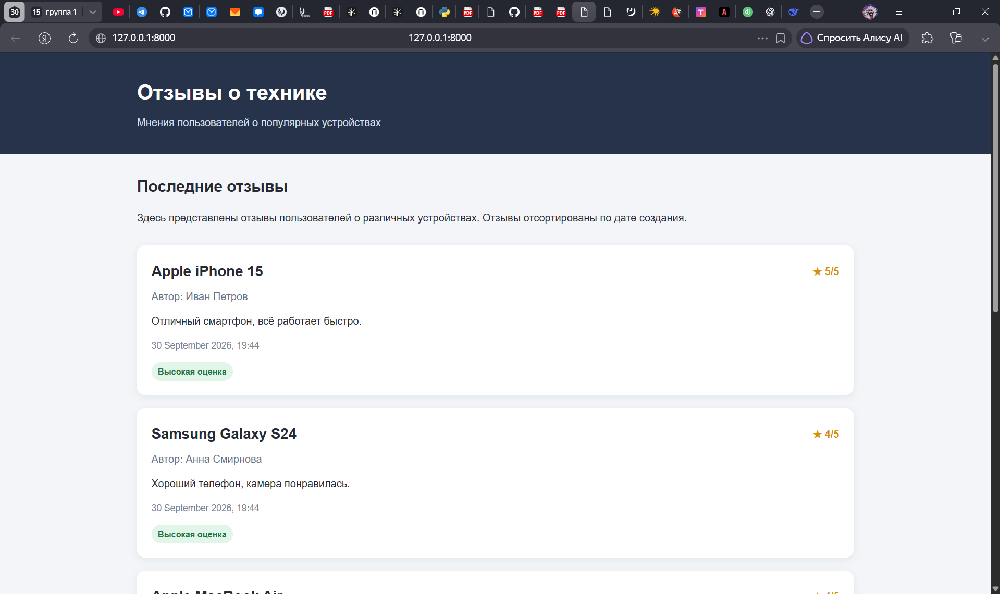
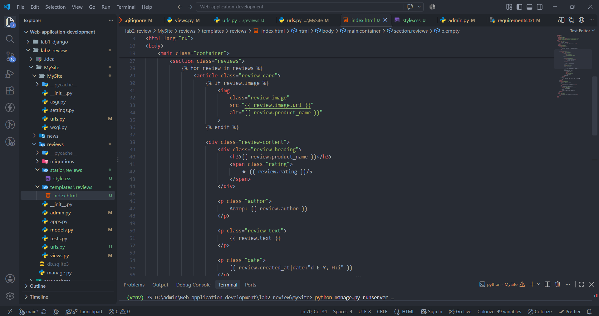
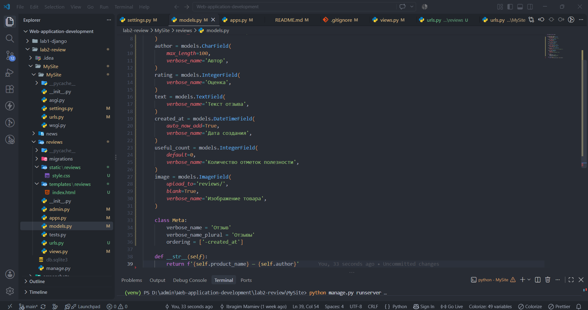
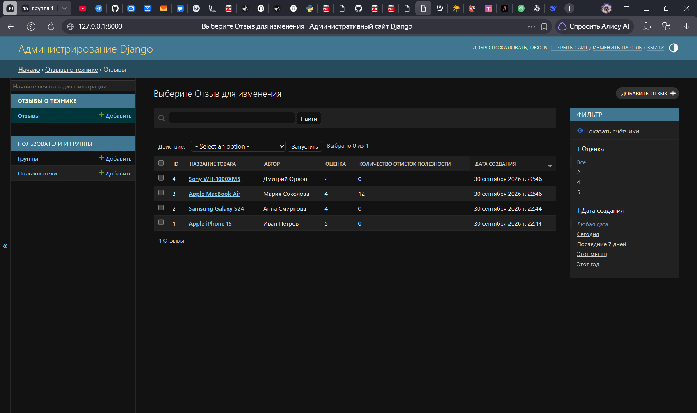
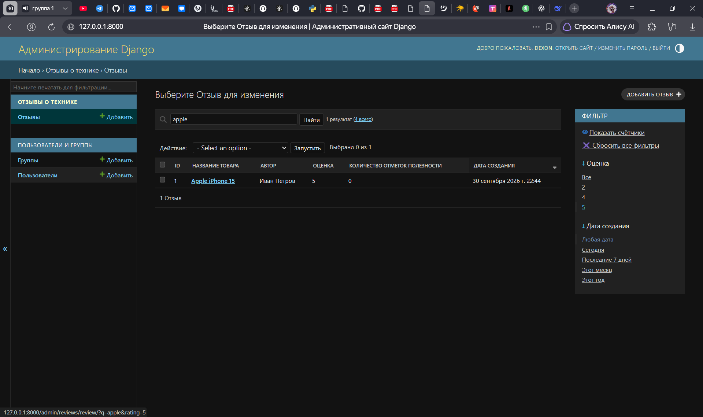
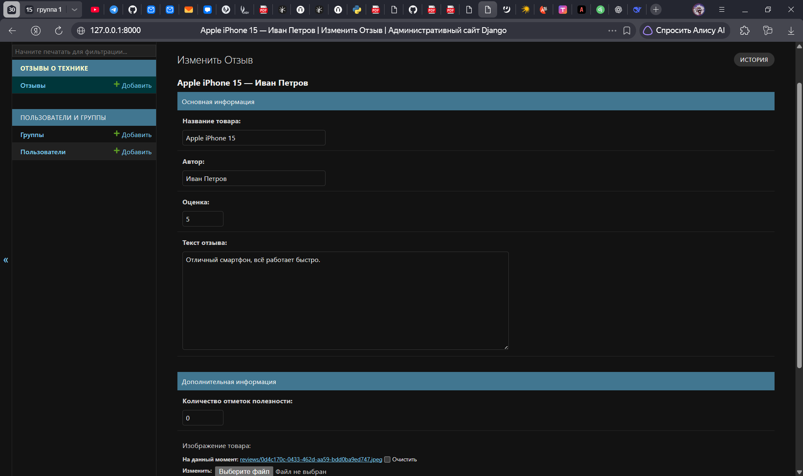
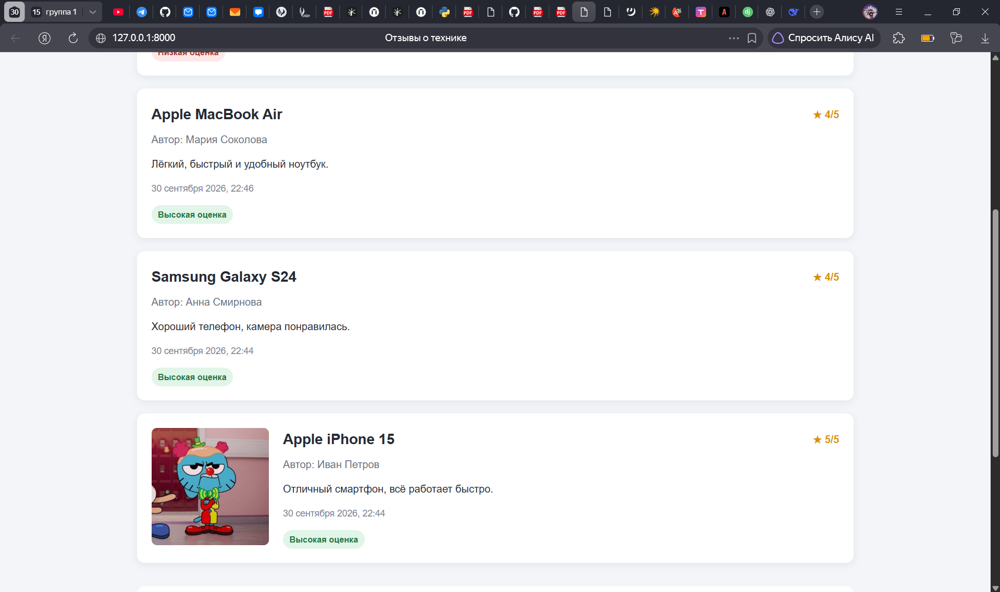
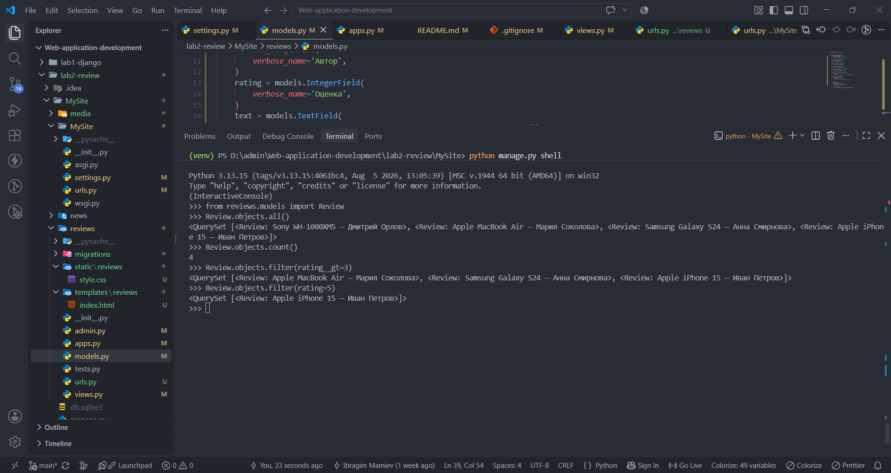

# Лабораторная работа № 3. Шаблоны и административная панель Django

## 1. Тема работы

Использование шаблонов Django для отображения данных и настройка административной панели для управления записями модели.

## 2. Цель работы

Изучить механизм формирования HTML-страниц с помощью шаблонов Django, научиться передавать данные из представлений в шаблоны, использовать переменные, циклы, условия и фильтры. Освоить настройку административной панели Django для управления объектами модели.

## 3. Используемые технологии

- Python 3.13;
- Django 6.1.1;
- SQLite;
- HTML;
- CSS;
- Django ORM;
- Django Admin.

## 4. Структура проекта

В ходе выполнения лабораторной работы проект был дополнен шаблонами и статическими файлами приложения `reviews`.

```text
lab2-review/
├── MySite/
│   ├── MySite/
│   │   ├── settings.py
│   │   └── urls.py
│   ├── reviews/
│   │   ├── migrations/
│   │   ├── templates/
│   │   │   └── reviews/
│   │   │       └── index.html
│   │   ├── static/
│   │   │   └── reviews/
│   │   │       └── style.css
│   │   ├── admin.py
│   │   ├── apps.py
│   │   ├── models.py
│   │   ├── urls.py
│   │   └── views.py
│   ├── news/
│   ├── media/
│   ├── db.sqlite3
│   └── manage.py
├── screenshots/
├── README.md
├── README_LAB3.md
└── requirements.txt
```

## 5. Работа с шаблонами Django

Для отображения отзывов было создано представление `index` в файле `reviews/views.py`.

Представление получает все записи модели `Review`, а также отдельно выбирает отзывы с оценкой выше 3.

```python
from django.shortcuts import render

from .models import Review


def index(request):
    reviews = Review.objects.all()

    high_rated_reviews = Review.objects.filter(
        rating__gt=3,
    )

    context = {
        'reviews': reviews,
        'high_rated_reviews': high_rated_reviews,
    }

    return render(request, 'reviews/index.html', context)
```

Данные передаются в HTML-шаблон через словарь `context`.

В шаблоне используются переменные Django, циклы, условия и фильтры. Это позволяет формировать страницу на основе содержимого базы данных.

## 6. Использование переменных, циклов и условий

Для отображения отзывов применяется цикл:

```django

    <h3>{{ review.product_name }}</h3>
    <p>{{ review.author }}</p>
    <p>{{ review.text }}</p>

```

Для проверки оценки используется условие:

```django

    <span>Высокая оценка</span>

    <span>Низкая оценка</span>

```

Для форматирования даты используется фильтр:

```django
{{ review.created_at|date:"d E Y, H:i" }}
```

Если список отзывов пуст, шаблон выводит соответствующее сообщение с помощью блока ``.

## 7. Сортировка данных

В модели `Review` задан параметр `ordering`:

```python
class Meta:
    ordering = ['-created_at']
```

Символ `-` указывает на сортировку по убыванию. Поэтому сначала отображаются наиболее новые отзывы.

## 8. Настройка административной панели

Модель `Review` зарегистрирована в административной панели с помощью декоратора `@admin.register(Review)`.

Для отображения записей используются следующие параметры:

- `list_display` — набор колонок списка;
- `list_display_links` — поле для перехода к редактированию;
- `list_filter` — фильтрация по оценке и дате;
- `search_fields` — поиск по названию товара, автору и тексту;
- `ordering` — сортировка записей;
- `fieldsets` — группировка полей формы редактирования.

В результате административная панель позволяет просматривать, искать, фильтровать, создавать и редактировать отзывы.

## 9. Загрузка изображений

В модель `Review` добавлено необязательное поле:

```python
image = models.ImageField(
    upload_to='reviews/',
    blank=True,
    verbose_name='Изображение товара',
)
```

Изображения сохраняются в каталоге `media/reviews/`.

Для обработки изображений используется библиотека Pillow. В настройках Django определены параметры `MEDIA_URL` и `MEDIA_ROOT`.

В шаблоне изображение выводится только в том случае, если оно было загружено:

```django

    

```

## 10. Проверка работы проекта

После выполнения миграций проект был запущен командой:

```bash
python manage.py runserver
```

Была проверена работа страницы отзывов и административной панели.

На странице сайта отображаются данные из базы SQLite. В административной панели доступны просмотр, поиск, фильтрация и редактирование отзывов.

Дополнительно была проверена выборка отзывов с оценкой выше 3:

```python
Review.objects.filter(rating__gt=3)
```

## 11. Результаты работы

В ходе лабораторной работы были изучены и реализованы:

- передача данных из представления Django в шаблон;
- вывод записей модели с помощью шаблонного языка Django;
- применение переменных, циклов, условий и фильтров;
- сортировка записей по дате создания;
- настройка административной панели;
- поиск и фильтрация объектов модели;
- загрузка и отображение изображений;
- использование Django ORM для получения данных.

В результате была создана страница отзывов о технике, связанная с существующей базой данных проекта.

## 12. Скриншоты

<details>
<summary>Скриншот 1. Страница отзывов</summary>



</details>

<details>
<summary>Скриншот 2. HTML-шаблон Django</summary>



</details>

<details>
<summary>Скриншот 3. Модель Review</summary>



</details>

<details>
<summary>Скриншот 4. Список отзывов в админке</summary>



</details>

<details>
<summary>Скриншот 5. Поиск и фильтрация</summary>



</details>

<details>
<summary>Скриншот 6. Форма редактирования отзыва</summary>



</details>

<details>
<summary>Скриншот 7. Отображение изображения на сайте</summary>



</details>

<details>
<summary>Скриншот 8. Проверка базы данных</summary>



</details>
